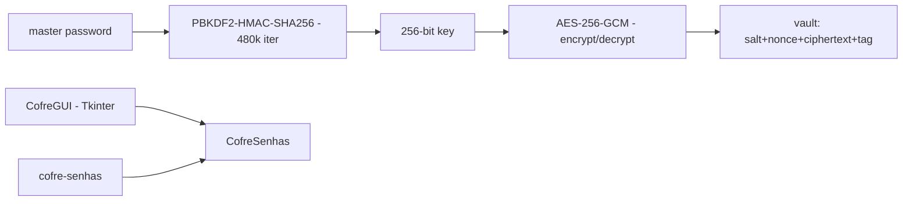

# cofre-senhas-aes256

**English** · [Português (Brasil)](README.md)

[](#) [](#) [](#) [](LICENSE)

## What it is

**A password vault with AES-256-GCM encryption**: it stores passwords in an encrypted file, with the key derived from the master password via **PBKDF2-HMAC-SHA256** (480,000 iterations, 16-byte salt). Vault format: `salt (16B) || nonce (12B) || ciphertext+tag`. It has a **GUI (Tkinter)** and a CLI. It is an educational applied-cryptography lab.

## Status

An educational lab, working and tested (20 tests).

## Features

- **Vault** (`cofre.py`): `CofreSenhas` with `derivar_chave` (PBKDF2-HMAC-SHA256, 256 bits), AES-256-GCM encrypt/decrypt (12-byte nonce, embedded tag), and `Senha` entries.
- **Errors** (`CofreError`): a wrong master password/tampered file fails the GCM tag verification.
- **GUI** (`gui.py`): `CofreGUI(tk.Tk)` — a Tkinter interface to open/add/list.
- **CLI**: `cofre-senhas` (`__main__.py`).
- **Default**: configurable `CAMINHO_PADRAO` for the vault file.

## Architecture

A `cofre_senhas_aes256` package with `cofre.py` (cryptography and persistence) and `gui.py` (Tkinter), plus the CLI.



## Stack

- Python ≥ 3.10
- cryptography ≥ 42.0, < 51 (only dependency)
- Tkinter (GUI, bundled with Python)

## Repository layout

```
cofre-senhas-aes256/
├── pyproject.toml · BRIEF.md
├── src/cofre_senhas_aes256/
│   ├── cofre.py   # PBKDF2 + AES-256-GCM + persistence
│   └── gui.py     # Tkinter interface
├── tests/         # 20 tests
└── LICENSE        # MIT
```

## Prerequisites and installation

```bash
pip install -e .
```

## How to run

```bash
cofre-senhas            # CLI
python -m cofre_senhas_aes256.gui   # Tkinter GUI
```

## Tests and quality

Real command (verified by the agent):

```bash
PYTHONPATH=src python -m pytest tests/
# 20 passed
```

## Technical decisions and trade-offs

- **PBKDF2 with 480,000 iterations**: a conservative parameter aligned with OWASP guidance for master passwords; Argon2id would resist GPUs better but is not available in this cryptography format.
- **AES-256-GCM**: confidentiality + integrity (tag) in a single primitive; any file tampering fails decryption.
- **Single `salt||nonce||ciphertext+tag` format**: simple and self-describing.

## Known limitations and roadmap

- No master-password change (recreate the vault).
- No attempt lockout, no vault backup/versions.
- Educational use: for production, prefer audited managers (KeePassXC, Bitwarden).

## Development process

An individual project by Kelvin Oliveira, built with orchestrated AI agents and reviewed by the author.

## License and author

MIT — Copyright (c) 2026 Kelvin Rebelo de Oliveira. Author: [Kelvin Oliveira](https://github.com/KelvinOliveiraCode) · [Portfolio](https://kelvinoliveiracode.github.io/portfolio/)
