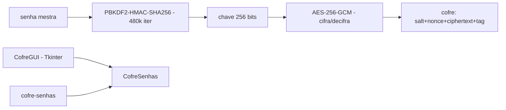

# cofre-senhas-aes256

[English](README.en.md) · **Português (Brasil)**

[](#) [](#) [](#) [](LICENSE)

## O que é

**Cofre de senhas com criptografia AES-256-GCM**: guarda senhas num arquivo cifrado, com chave derivada da senha mestra por **PBKDF2-HMAC-SHA256** (480.000 iterações, salt de 16 bytes). Formato do cofre: `salt (16B) || nonce (12B) || ciphertext+tag`. Interface **GUI (Tkinter)** e CLI. É um laboratório educacional de criptografia aplicada.

## Status

Laboratório educacional funcional e testado (20 testes).

## Funcionalidades

- **Cofre** (`cofre.py`): `CofreSenhas` com `derivar_chave` (PBKDF2-HMAC-SHA256, 256 bits), cifra/decifra AES-256-GCM (nonce de 12 bytes, tag embutida), entradas `Senha`.
- **Erros** (`CofreError`): senha mestra errada/corrompido falham na verificação da tag GCM.
- **GUI** (`gui.py`): `CofreGUI(tk.Tk)` — interface Tkinter para abrir/adicionar/listar.
- **CLI**: `cofre-senhas` (`__main__.py`).
- **Padrão**: `CAMINHO_PADRAO` do arquivo do cofre configurável.

## Arquitetura

Pacote `cofre_senhas_aes256` com `cofre.py` (criptografia e persistência) e `gui.py` (Tkinter), mais a CLI.



## Stack

- Python ≥ 3.10
- cryptography ≥ 42.0, < 51 (única dependência)
- Tkinter (GUI, incluído no Python)

## Estrutura do repositório

```
cofre-senhas-aes256/
├── pyproject.toml · BRIEF.md
├── src/cofre_senhas_aes256/
│   ├── cofre.py   # PBKDF2 + AES-256-GCM + persistência
│   └── gui.py     # interface Tkinter
├── tests/         # 20 testes
└── LICENSE        # MIT
```

## Pré-requisitos e instalação

```bash
pip install -e .
```

## Como executar

```bash
cofre-senhas            # CLI
python -m cofre_senhas_aes256.gui   # GUI Tkinter
```

## Testes e qualidade

Comando real (verificado pelo agente):

```bash
PYTHONPATH=src python -m pytest tests/
# 20 passed
```

## Decisões técnicas e trade-offs

- **PBKDF2 com 480.000 iterações**: parâmetro conservador e padrão do OWASP para senhas mestras; Argon2id seria mais resistente a GPU, mas não está na stdlib do cryptography nesse formato.
- **AES-256-GCM**: confidencialidade + integridade (tag) numa primitiva só; qualquer adulteração do arquivo falha a decifra.
- **Formato único `salt||nonce||ciphertext+tag`**: simples e autodescritivo.

## Limitações conhecidas e roadmap

- Sem troca de senha mestra (recriar o cofre).
- Sem bloqueio por tentativas, sem backup/versões do cofre.
- Uso educacional: para produção, prefira gerenciadores auditados (KeePassXC, Bitwarden).

## Processo de desenvolvimento

Projeto individual de Kelvin Oliveira, construído com agentes de IA orquestrados e revisado pelo autor.

## Licença e autor

MIT — Copyright (c) 2026 Kelvin Rebelo de Oliveira. Autor: [Kelvin Oliveira](https://github.com/KelvinOliveiraCode) · [Portfólio](https://kelvinoliveiracode.github.io/portfolio/)
